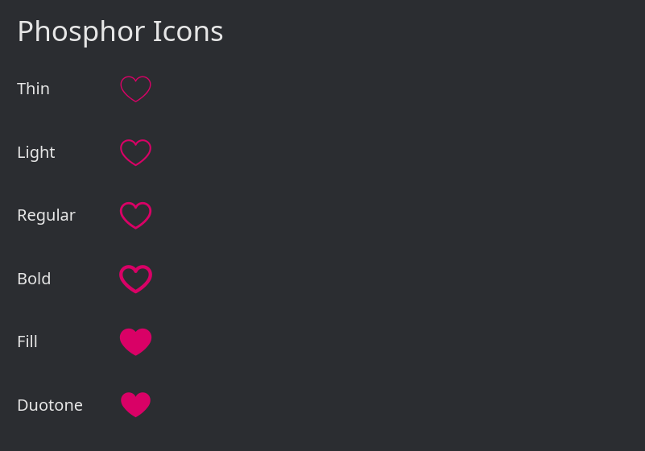

# iced_phosphor

Phosphor Icons for [Iced](https://iced.rs/), a cross-platform GUI library for Rust.

This crate bundles the Phosphor font files and provides icon functions that return Iced `Text` widgets.

## Features

- Six icon weights: Thin, Light, Regular, Bold, Fill, and Duotone.
- Generated Rust functions for the icons included in the Phosphor selection files.
- Icon functions return `iced::widget::Text<'static>` widgets.



## Installation

Add the crate to your `Cargo.toml`:

```toml
[dependencies]
iced_phosphor = "0.1.0"
```

## Usage

```rust
use iced::widget::{column, text};
use iced::{Alignment, Element, Theme, color};

use iced_phosphor::{fill, regular}; // Import variants

fn main() -> iced::Result {
    iced::application(|| (), update, view)
        .title("Phosphor Icons")
        .theme(Theme::Dark)
        .font(iced_phosphor::FONT_FILL) // Register fonts
        .font(iced_phosphor::FONT_REGULAR)
        .run()
}

fn update(_: &mut (), _: ()) {}

fn view(_: &()) -> Element<'_, ()> {
    column![
        text("Regular heart").size(20),
        regular::heart().size(32).color(color!(0xd90166)), // Call icons

        text("Filled heart").size(20),
        fill::heart().size(32).color(color!(0xd90166)),
    ]
    .spacing(12)
    .padding(24)
    .align_x(Alignment::Center)
    .into()
}
```

## Credits

This crate uses [Phosphor Icons](https://phosphoricons.com/).

Phosphor Icons are distributed under the MIT License.
See [LICENSE](./LICENSE) for the license text.
